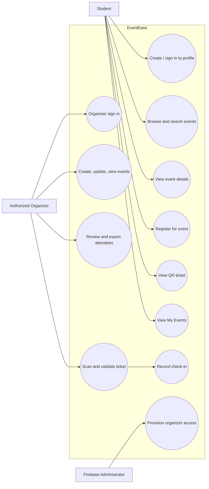
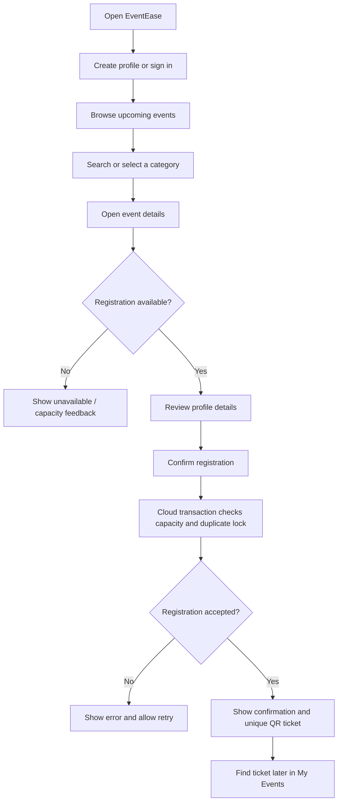
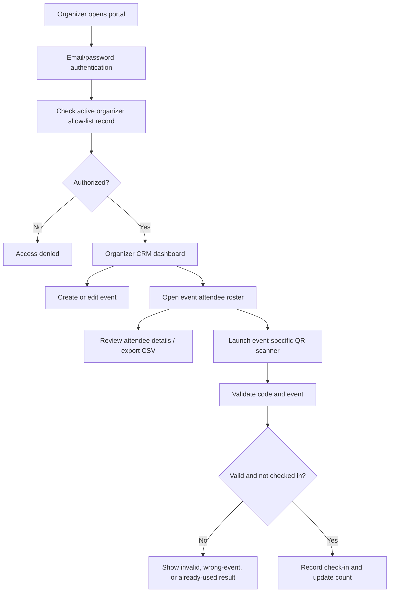
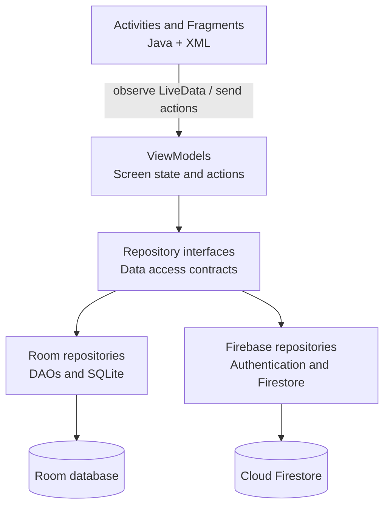
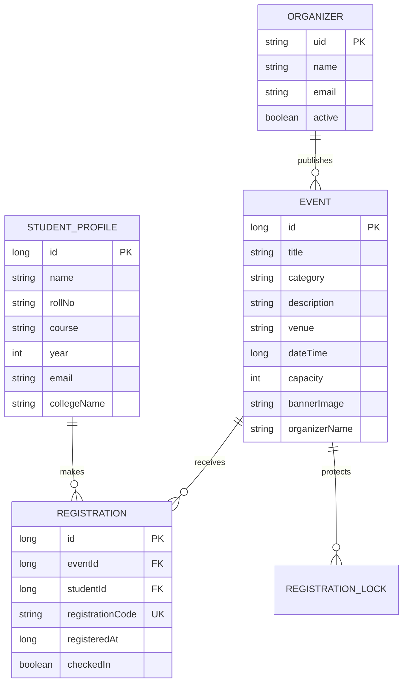

# EventEase — Project Presentation

> **Format:** Markdown slide deck. Each horizontal rule (`---`) marks a new slide/page.  
> **Suggested use:** Open in a Markdown presentation tool that supports Mermaid, or copy one slide at a time into PowerPoint/Google Slides.  
> **Visual theme:** Navy `#0D2545`, warm ivory `#FAF7F0`, and restrained gold `#C9A227` accents.

---

<!-- Slide 1: Cover -->

# EVENTEASE

## College Event Management & Registration App

### *Discover. Register. Experience.*

**Project Presentation**

**Presented by**  
**Pratham Chaavda** · Roll No. 17  
**Gaurav Dixit** · Roll No. 22

**Under the guidance of**  
**Dr. Kinjal Doshi**  
Head of Department (HOD)

**Thakur Institute of Management Studies, Career Development & Research (TIMSCDR)**

---

<!-- Slide 2: Project at a glance -->

# Project at a Glance

| Item | Description |
|---|---|
| Project name | **EventEase** |
| Domain | Education — college and campus event management |
| Application | Android mobile application |
| Primary users | Students and authorized event organizers |
| Student capabilities | Discover events, register, view ticket, and manage registered events |
| Organizer capabilities | Publish events, manage attendee records, and validate entry tickets |
| Main outcome | A connected event lifecycle from event publishing through attendee check-in |

**Project definition:** EventEase is a Java-based Android application that brings college event discovery, registration, digital QR tickets, organizer event management, and ticket check-in into one system. Shared event and registration information is synchronized through Firebase Cloud Firestore.

---

<!-- Slide 3: Background and context -->

# Background and Context

Colleges conduct academic, technical, cultural, sports, and professional-development events throughout the year. Information and registration processes can be spread across posters, messages, forms, and spreadsheets.

That separation creates practical work for both sides:

- Students need to find event details and understand how to register.
- Organizers need a current attendee list and a way to communicate event information.
- At the venue, staff need to check registered attendees and record attendance.
- When counts are maintained manually, updates can be delayed or duplicated.

EventEase combines these related tasks in a single mobile workflow for students and organizers.

---

<!-- Slide 4: Problem statement -->

# Problem Statement

**How can a college provide students with a simple way to discover and register for events while giving organizers a dependable way to manage registrations and verify event entry?**

### Challenges addressed

1. Event announcements may be distributed through multiple channels.
2. Registration lists may need manual consolidation and updates.
3. Students may not have one convenient place to see their registrations.
4. Manual ticket checking can slow entry and make attendance records harder to maintain.
5. Organizers need registration and check-in counts that reflect current cloud data.

### Project response

EventEase provides a shared event catalogue, student registration and QR ticket flow, organizer CRM, and QR-based check-in.

---

<!-- Slide 5: Aim and objectives -->

# Aim and Objectives

## Aim

To develop a mobile event-management system that connects event discovery, registration, attendee management, and event-entry validation.

## Objectives

- Give students a searchable catalogue of upcoming college events.
- Present event category, date and time, venue, description, and imagery in the app.
- Provide a guided registration flow and a unique QR ticket after successful registration.
- Enforce event capacity and reduce duplicate registrations for the same student and event.
- Give authorized organizers tools to create, view, update, and manage events.
- Display attendee details and live registration/check-in totals to organizers.
- Validate a ticket against its event and record successful check-in once.
- Separate the user interface from data access using MVVM and repository interfaces.
- Support light, dark, and system appearance and optional event reminders.

---

<!-- Slide 6: Scope -->

# Project Scope

## Included in the current application

- Student profile creation and local profile-based sign-in.
- Event browsing, title search, category filtering, event details, and images.
- Registration with capacity and duplicate-registration checks.
- Unique registration code and QR ticket display.
- Upcoming and past registered events.
- Separate organizer sign-in with administrator-provisioned access.
- Event creation and editing; deletion is restricted when registrations exist.
- Organizer dashboard statistics and attendee roster.
- CSV attendee export and camera-based QR ticket scanning.
- Firestore synchronization for shared events, registrations, event images, and check-ins.
- Room persistence for local profiles and local demo operation.
- Light/dark/system themes and optional local reminders.

## Outside the current scope

- College-verified student identity or institutional single sign-on.
- Payment processing, ticket sales, and refunds.
- A web-based administration console or public event website.
- Automatic recovery of student ticket history on a different device.
- Firebase Storage for event images; compressed image data is kept with event documents.

---

<!-- Slide 7: Stakeholders and actors -->

# Stakeholders and Actors

| Actor | Main goal | Main actions in EventEase |
|---|---|---|
| Student | Find events and keep track of registrations | Create profile, browse/search/filter events, register, view QR ticket, view My Events |
| Organizer | Plan events and manage participation | Sign in, create/edit events, view counts and attendees, export roster, scan tickets |
| Department / college | Coordinate campus activities | Provide the institutional context, organizer oversight, and event catalogue |
| Administrator | Control organizer access | Create or deactivate the organizer allow-list record in Firestore |

### Important role distinction

Organizer access is based on Firebase Email/Password authentication **and** an active organizer record provisioned by an administrator. A Firebase account alone does not grant organizer privileges.

---

<!-- Slide 8: Use-case diagram -->

# Use-Case View

**Reading the diagram:** Students use the public event and registration experience. Organizers use a separately authenticated management experience. The administrator provisions organizer access outside the client app.

---

<!-- Slide 9: Student workflow -->

# Student Workflow

### Student experience details

- Event cards include category, title, date/time, venue, and an image.
- The student reviews the profile details before confirming registration.
- The confirmation screen links to the ticket.
- My Events separates upcoming and past registrations and reopens the ticket.

---

<!-- Slide 10: Organizer workflow -->

# Organizer Workflow

### Organizer CRM overview

The dashboard summarizes organizer-owned events, total registrations, and check-ins. Each event can be opened to review its attendees and scan a ticket for that event.

---

<!-- Slide 11: Detailed registration workflow -->

# Registration Workflow — Detailed View

1. The app identifies the currently signed-in local student profile.
2. Before cloud registration, the profile details are published to the student's anonymous Firebase identity.
3. A registration code is generated for the ticket.
4. Firestore runs a transaction that reads the event, student profile, per-event registration lock, ticket code, and registration counter.
5. The transaction rejects a missing event, mismatched student profile, existing lock, code collision, or full event.
6. If checks pass, it writes the registration and lock, advances the counter, and increments the event's registered count atomically.
7. The app presents success and generates the QR image from the unique registration code.
8. The registration listener supplies the ticket to My Events.

### Why use a transaction?

Two students may attempt to claim the final place at nearly the same time. A transaction rechecks the current count and applies the registration and counter update together, reducing the risk of overselling capacity.

---

<!-- Slide 12: Ticket and check-in workflow -->

# QR Ticket and Check-In

### QR ticket contains

- A unique EventEase registration code.
- It is shown as a QR image on the student's ticket screen.
- The ticket also displays event and student information for human review.
- A TIMSCDR crest appears on a white background and is overlaid at the center of the QR.

### Check-in validation

- The organizer opens the scanner from the selected event's roster.
- The scanned code is looked up in Firestore.
- The app confirms the registration exists and belongs to the event being scanned.
- The ticket must not already be checked in.
- A successful scan records the checked-in state and time, and increases the event check-in count.
- A repeat scan is reported as already used; an unknown or wrong-event ticket is rejected.

### Design principle

The QR contains a reference code, while the authoritative registration and check-in state remain in Firestore.

---

<!-- Slide 13: System architecture -->

# System Architecture — MVVM

### Separation of responsibilities

- **Activity / Fragment:** Renders XML, handles navigation and forwards user actions.
- **ViewModel:** Holds screen state and coordinates user actions without owning view code.
- **Repository interface:** Defines the data operations expected by the app layer.
- **Room implementation:** Supports local persistence and the local demo configuration.
- **Firebase implementation:** Provides shared cloud events, registration, and organizer data.

This boundary keeps data-source work out of the presentation layer and makes repository implementations replaceable without rewriting the screens.

---

<!-- Slide 14: Application components -->

# Main Application Components

| Component | Responsibility |
|---|---|
| `data/entity` | Defines Event, Registration, and StudentProfile data models |
| `data/dao` | Defines Room database operations for local persistence |
| `data/database` | Creates the Room database and schema migration |
| `repository` | Implements data contracts with Room or Firebase and coordinates sync |
| `viewmodel` | Exposes screen state and business actions to the UI |
| `ui/auth` | Student login and signup screens |
| `ui/dashboard` | Event catalogue and bottom navigation |
| `ui/registration` | Registration form, confirmation, and QR ticket screens |
| `ui/organizer` | Organizer CRM, event management, roster, export, and scanner |
| `ui/profile` | Student profile and settings |
| `util` | QR generation, event imagery, navigation, date/time, and reminders |
| `receiver` | Receives scheduled local event reminder alarms |

---

<!-- Slide 15: Data model -->

# Data Model

### Model notes

- Room stores local StudentProfile, Event, and Registration entities.
- Event and registration timestamps are represented in epoch milliseconds.
- Room enforces a unique local registration code and one registration per event/student pair.
- Firestore uses document IDs for event IDs, ticket codes, student UIDs, organizer UIDs, and per-event roll-number locks.
- Cloud registration records include attendee snapshot fields used by the organizer roster.

---

<!-- Slide 16: Cloud collections and synchronization -->

# Firebase Data and Synchronization

| Firestore collection / document | Purpose |
|---|---|
| `events/{eventId}` | Shared event details, capacity, image data, organizer ownership, registration and check-in totals |
| `students/{anonymousUid}` | Student profile snapshot and roll-number hash used by cloud rules and duplicate locks |
| `registrations/{registrationCode}` | Ticket, student snapshot, event reference, registration time, and check-in status |
| `registrationLocks/{eventId_rollKey}` | Prevents another registration with the same roll-number hash for that event |
| `organizers/{organizerUid}` | Administrator-managed authorization record, including active status |
| `system/ids` | Shared counters for event and registration IDs |

### Sync behaviour

- Event catalogue, attendee roster, counts, and registration state use Firestore listeners for live updates.
- Registration and check-in updates use Firestore transactions.
- Organizer image selection is compressed on-device to a maximum of 20 KiB and stored as image data in the event document.
- The organizer uses a separate named Firebase app session so organizer sign-in/out does not replace the device's student anonymous Firebase session.
- If Firebase configuration is absent, the app uses local Room repositories for the local demo; cloud sharing then is unavailable.

---

<!-- Slide 17: Security and access control -->

# Security and Access Control

- Firestore rules require an authenticated Firebase identity for protected writes.
- Organizer permissions require an active `organizers/{uid}` allow-list document.
- Organizer documents cannot be created or modified by the client app.
- Organizer event queries and changes are scoped to the signed-in organizer's UID.
- Student profile documents are scoped to that student's anonymous Firebase UID.
- Registration rules verify profile ownership, roll-key consistency, event capacity, and the associated lock.
- Check-in rules allow the event owner to change an unused registration to checked-in and update the matching count.
- Registration and lock deletion are denied to preserve ticket history and counter integrity.
- A separate Firebase Auth session prevents organizer authentication from signing out the student identity.

### Identity limitation to explain honestly

The student's name and roll number are supplied in the app and are not verified against college records. Anonymous sync identity is installation-specific, so a student's ticket history does not automatically migrate to a new phone or after app data is cleared. The organizer CRM still retains the cloud registration record.

---

<!-- Slide 18: UI and design system -->

# User Interface and Design

### Visual identity

- Primary navy: `#0D2545` in light mode and `#1B3A63` in dark mode.
- Gold accent: `#C9A227` in light mode and `#D4AF37` in dark mode; reserved for accents.
- Warm ivory light background and deep navy-black dark background.
- Locally bundled Playfair Display headings and Inter body text.
- TIMSCDR crest used on branded screens, splash/ticket surfaces, and launcher icon.
- Event artwork uses organizer-selected images or bundled category artwork as a fallback.

### Main screens

1. Splash and student authentication.
2. Student event dashboard with navigation for Events, My Events, and Profile.
3. Event details and registration form.
4. Registration confirmation and QR ticket.
5. Organizer sign-in and CRM dashboard.
6. Event creation/edit form, attendee roster, CSV export, and scanner.
7. Settings for theme, notifications, and About information.

### Interaction considerations

The layouts use scrollable forms and lists for varying content lengths, explicit loading/error states, Android system image selection, and permission-aware camera and notification features.

---

<!-- Slide 19: Technology stack -->

# Technology Stack

| Area | Technology | Use in EventEase |
|---|---|---|
| Language | Java 17 | Android application logic |
| UI | XML layouts, AndroidX, Material Components | Screens, navigation, inputs, cards, and themes |
| Architecture | MVVM, ViewModel, LiveData, repositories | UI/data separation and observable screen state |
| Local persistence | Room / SQLite | Local profile and demo data |
| Shared backend | Firebase Authentication, Cloud Firestore | Organizer auth, anonymous student sync, shared event/registration data |
| QR | ZXing Core and JourneyApps scanner | Ticket generation and organizer scanning |
| Images | Glide | Image decoding, loading, and display |
| Reminders | AlarmManager, NotificationCompat | Optional local event reminder |
| Build | Gradle wrapper, Android Gradle Plugin | Command-line build without Android Studio-only workflow |

### Platform configuration

- Application ID: `com.timscdr.eventease`
- Minimum SDK: API 24 (Android 7.0)
- Compile SDK: 35
- Target SDK: 34

---

<!-- Slide 20: Testing and quality -->

# Testing and Quality Checks

### Automated checks performed

- **38 JVM unit tests passed** in the latest recorded project validation.
- The test suite covers repository and ViewModel logic, database behaviour, navigation/startup conditions, and selected UI flows.
- Android Lint reported **0 errors** and **21 warnings** at the time of the recorded build.
- A debug APK was built and its APK signature was verified.

### Device checks performed

- Installed the updated debug APK on a vivo1901 Android device.
- Confirmed student profile and existing Techthon registration remained after updating the app.
- Confirmed the organizer CRM showed the event and registration count.
- Signed out of the organizer portal and returned to the student side; the ticket remained in My Events.
- No crash or Firestore permission errors were present in the checked log output.

### What this testing does not prove

These checks cover a development build and selected flows. They are not a guarantee of zero defects on every device, Android version, network condition, or Firebase project configuration. The camera scanner and a full multi-device test should be demonstrated in the final test environment.

---

<!-- Slide 21: Demo plan -->

# Suggested Live Demonstration

### Part A — Student flow

1. Open EventEase and show the student Events tab.
2. Search or filter the catalogue and open an event.
3. Show event details and the registration action.
4. Complete/describe the confirmation flow and open the QR ticket.
5. Show the registered event in My Events.

### Part B — Organizer flow

1. Open the organizer sign-in page and sign in with the authorized account.
2. Show CRM totals and the event list.
3. Open an event's attendee list and point out registration details.
4. Show the CSV export action.
5. Launch the scanner and describe valid, invalid, wrong-event, and already-used outcomes.

### Demonstration tip

Use a test event and test profile, check network access beforehand, and have a screenshot or screen recording ready in case venue connectivity or the camera is unavailable.

---

<!-- Slide 22: Challenges and design decisions -->

# Challenges and Key Design Decisions

| Challenge | Design decision | Benefit |
|---|---|---|
| Keeping screens independent from storage | Activities/Fragments use ViewModels and repository contracts | UI logic does not directly depend on Room DAOs or Firebase APIs |
| Capacity under simultaneous registrations | Firestore transaction reads and updates event count with registration | Capacity is rechecked as part of the cloud write |
| Duplicate registration across installations | Per-event lock keyed by a normalized roll-number hash | Blocks repeat registrations for the same submitted roll number and event |
| Organizer access control | Email/password plus administrator-managed active organizer document | Authentication and authorization are checked separately |
| Student and organizer sessions interfering | Separate named Firebase app for organizer authentication | Organizer sign-in/out preserves the student anonymous sync session |
| Image sharing without Firebase Storage | Compress image data to at most 20 KiB and store in event document | Students can load the organizer's event art through Firestore |
| Ticket reuse at entry | Persist checked-in state and reject repeated scans | The roster and counts reflect whether a ticket has already been used |

---

<!-- Slide 23: Conclusion and future scope (kept together on one slide/page) -->

# Conclusion and Future Scope

## Conclusion

EventEase brings the main college event lifecycle into one Java Android application: organizers publish events; students discover and register; the app issues a unique QR ticket; and organizers review attendees and record check-in. MVVM and repository interfaces separate screen behaviour from data access, Room supports local persistence, and Firebase provides shared event and registration data across connected devices.

The project demonstrates Android UI development, local and cloud persistence, authentication and authorization, transactional data updates, QR code generation and validation, and a multi-role application workflow.

## Future Scope

- Add institution-verified student authentication and profile validation.
- Link student accounts to a durable identity so tickets can be restored on a new device.
- Add organizer announcements, reminders, and event-change notifications.
- Add attendance reports, category analytics, and downloadable event summaries.
- Improve offline operation and provide clear queued-sync/retry states.
- Move image storage to a dedicated object-storage service if image volume grows beyond Firestore's suitable usage.
- Add automated integration tests for multi-device sync, authorization rules, QR scanning, and network failure cases.
- Add accessibility review, localization, and broader device testing.

---

<!-- Slide 24: Final slide — intentionally contains only thank you and member names/roll numbers -->

# THANK YOU

## Pratham Chaavda · Roll No. 17

## Gaurav Dixit · Roll No. 22

